# Architecture

One pipeline, one parser engine, one visitor family per language.

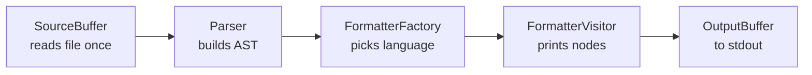

The ASCII version of the same path:

```
SourceBuffer → Parser → AST → FormatterVisitor → OutputBuffer → stdout
                             (one per language)     ↑
ThreadPool fans multi-file runs out; each job owns its buffer+parser.
```

## How a file flows through

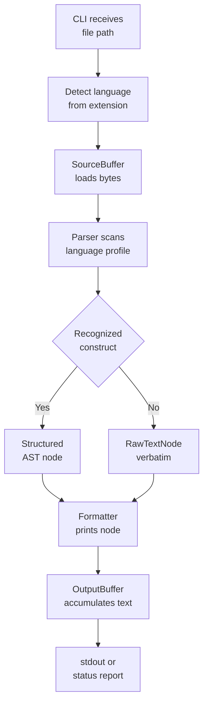

## Class hierarchy

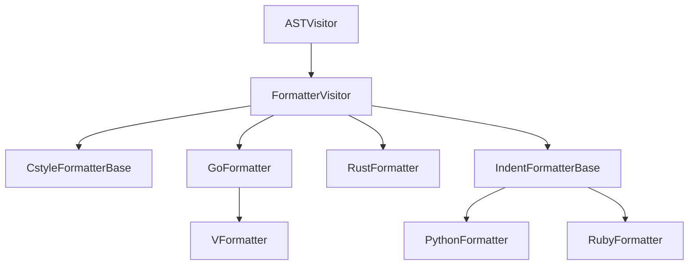

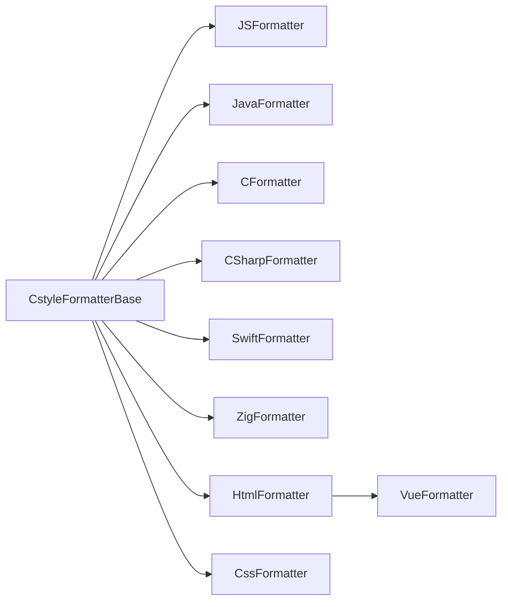

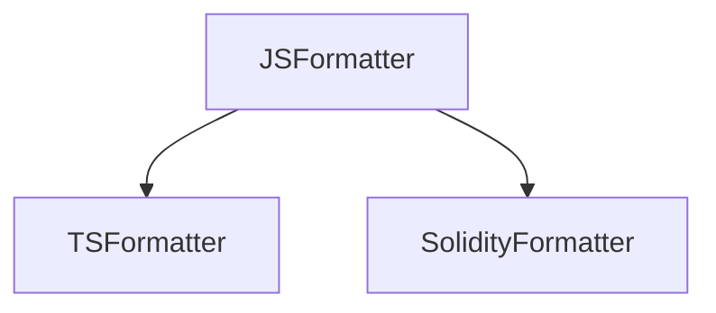

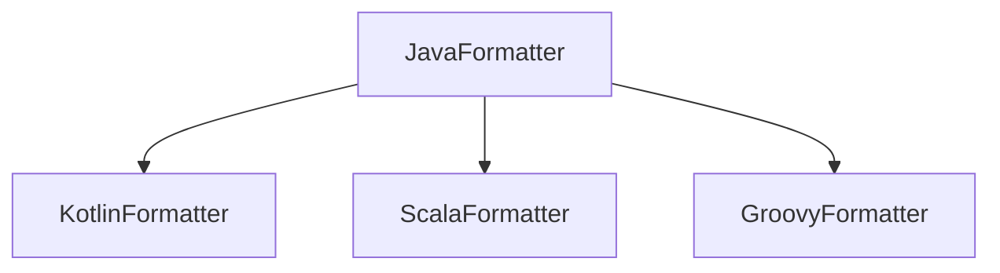

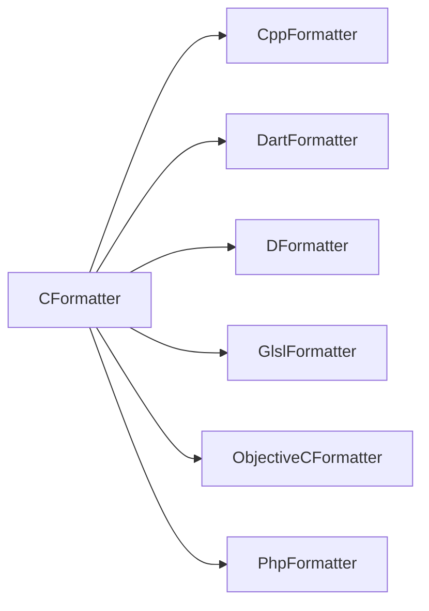

The same tree as text:

```
ASTNode (abstract)
├── ProgramNode, FunctionDeclNode, VariableDeclNode, IfStmtNode,
│   ForStmtNode, WhileStmtNode, SwitchStmtNode, BlockNode,
│   ReturnStmtNode, ThrowStmtNode, TryCatchStmtNode, CommentNode,
│   LiteralNode, IdentifierNode, ArrayLiteralNode, ObjectLiteralNode,
│   TemplateLiteralNode, ArrowFunctionNode, ClassDeclNode,
│   InterfaceDeclNode, EnumDeclNode, TypeAliasNode, ImportDeclNode,
│   ExportDeclNode, PreprocessorDirectiveNode, NamespaceNode,
│   PropertyNode, RawTextNode, HtmlElementNode, WithNode,
│   SwitchCaseNode
│
ASTVisitor
├── FormatterVisitor (abstract)
│   ├── CstyleFormatterBase            <-- master class
│   │   ├── JSFormatter → TSFormatter, SolidityFormatter
│   │   ├── JavaFormatter → KotlinFormatter, ScalaFormatter, GroovyFormatter
│   │   ├── CFormatter → CppFormatter, DartFormatter, DFormatter,
│   │   │                GlslFormatter, ObjectiveCFormatter, PhpFormatter
│   │   ├── CSharpFormatter
│   │   ├── SwiftFormatter, ZigFormatter
│   │   └── HtmlFormatter → VueFormatter
│   │   └── CssFormatter
│   ├── GoFormatter → VFormatter
│   ├── RustFormatter
│   └── IndentFormatterBase          <-- megaclass (no braces)
│       ├── PythonFormatter (colon suites, pass, match/case)
│       └── RubyFormatter (end suites, do blocks, heredocs)
├── StyleDetector   (fmtpp learn → .fmtpp.toml)
└── ASTPrinter      (debug tree dumps)
```

`CstyleFormatterBase` owns the template-method pattern: `visit*` walks
the node, `print*` pieces are virtual so subclasses override only what
differs (`visitFunctionDecl`, `visitClassDecl`, …). Go/Rust extend
`FormatterVisitor` directly (no semicolons, different blocks).
`FormatterFactory` is the single home for extension→language mapping
and formatter construction; CLI, thread pool and benchmark all use it.

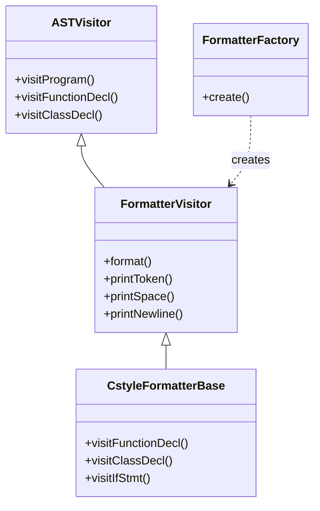

## The parser

One shared engine with per-language profiles: comment/string/regex
aware scanning, depth tracking, per-language keywords for declarations,
imports, control flow and attributes. Leaf expressions stay verbatim
and anything unrecognized becomes `RawTextNode`, so output is never
invented. HTML/XML parse as tag trees, JSON with a strict mini-parser,
Vue SFCs as HTML with per-block sub-formatting. Python parses with an
indentation engine (logical lines, suite holders for if/try/loop
chains); Ruby with an end-delimited segment engine (holders for
if/case/begin/method chains, heredoc and `=begin` awareness).

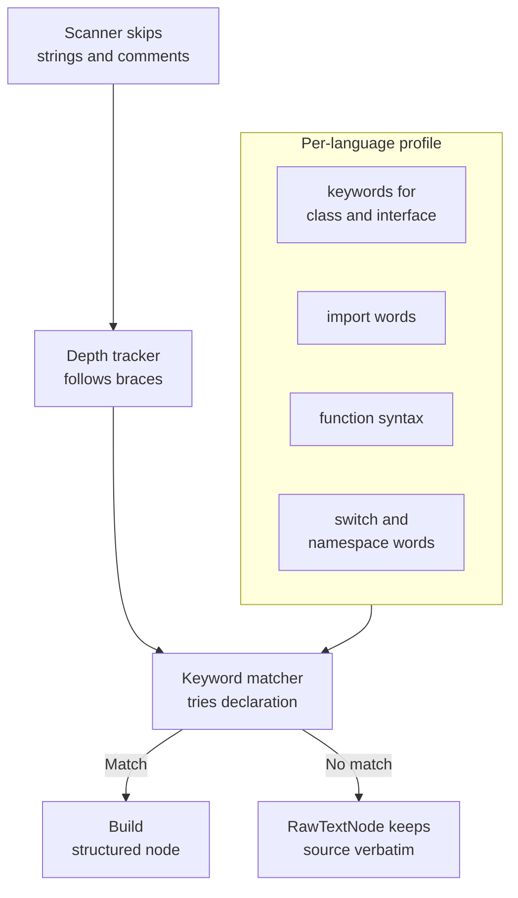

## Parser profile catalog

Each row is one `LangProfile` in `src/Parser.cpp`: whether statements
end in semicolons, whether `#` lines are directives, and which keywords
open classes, interfaces, enums, and functions.

| Lang | `;` | `#dir` | Classes | Interfaces | Enums | Functions |
|---|---|---|---|---|---|---|
| js | yes | no | `class` | `interface` | `enum` | `function` (bare) |
| ts | yes | no | `class` | `interface` | `enum` | `function` (colon) |
| java | yes | no | `class` | `interface` | `enum` | prefix style |
| c | yes | yes | — | — | `enum` | prefix style |
| cpp | yes | yes | `class struct union` | — | `enum` | prefix style |
| cs | yes | yes | `class struct record` | `interface` | `enum` | prefix style |
| go | no | no | — | `interface` | — | `func` (trailing) |
| rs | yes | no | `struct union impl` | `trait` | `enum` | `fn` (arrow) |
| kotlin | no | no | `class object` | `interface` | `enum` | `fun` (colon) |
| swift | no | no | `class struct actor` | — | `enum` | `func` (arrow) |
| dart | yes | no | `class` | `interface` | `enum` | prefix style |
| php | yes | no | `class interface trait enum` | — | — | `function` (colon) |
| scala | no | no | `class object trait` | — | `enum` | `def` (colon) |
| objc | yes | yes | `@interface @implementation` | `@protocol` | `enum` | raw style |
| zig | yes | no | — | — | — | `fn` (trailing) |
| d | yes | yes | `class struct union` | `interface` | `enum` | prefix style |
| groovy | no | no | `class` | `interface` | `enum` | `def` (colon) |
| solidity | yes | no | `contract interface library` | — | — | `function` (bare) |
| v | no | yes | `struct` | `interface` | `enum` | `fn` (trailing) |
| glsl | yes | yes | `struct` | — | — | prefix style |
| python | no | no | `class` | — | — | `def` (colon suites) |
| ruby | no | no | `class` | — | — | `def` (bare, `end`) |

`—` means the profile declares no keyword: the construct either does
not exist in the language or parses through the generic path. Function
syntax tags (`FS_BARE`, `FS_COLON`, `FS_CPREFIX`, `FS_TRAIL`,
`FS_ARROW`, `FS_RAW`) select how headers are split into name, params,
and return type.

## Single-file run

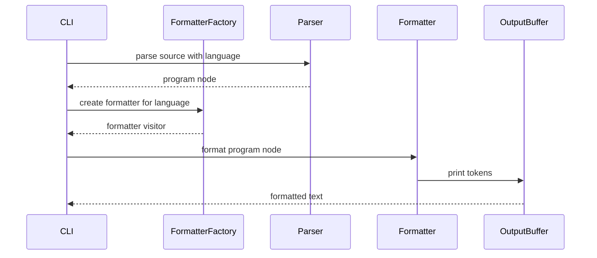

## Multi-file parallel run

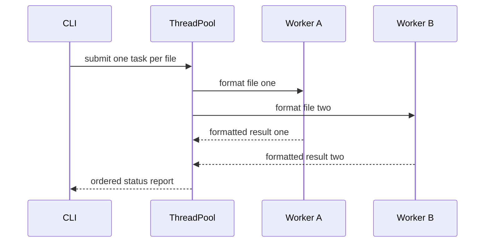

## Python indentation engine

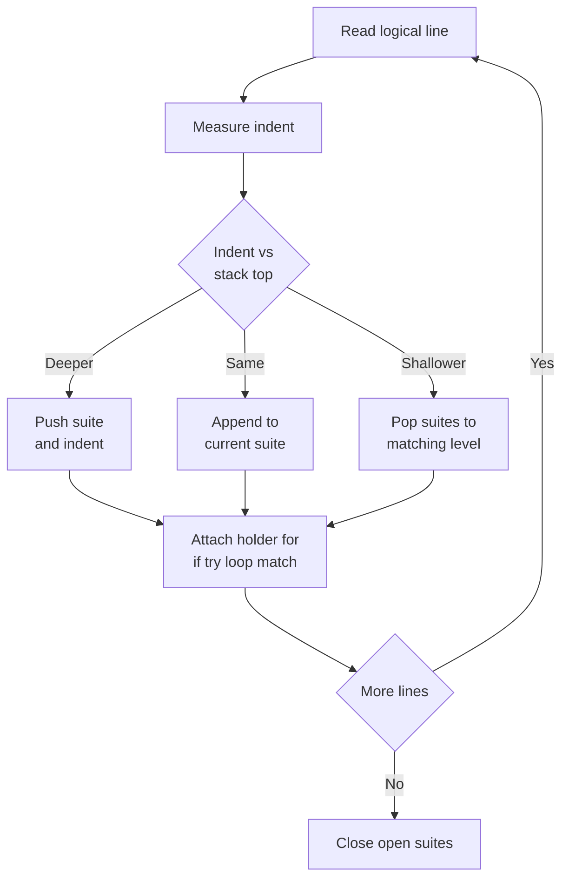

## Ruby end-delimited engine

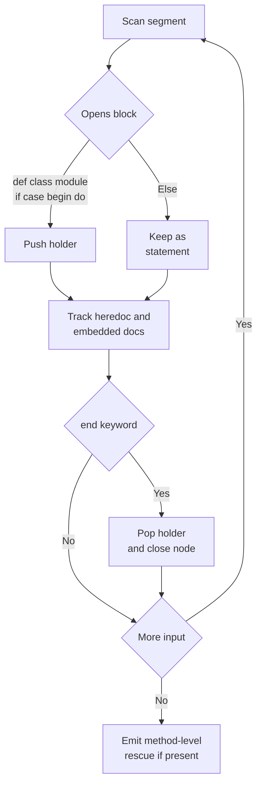

## Performance strategy

- **`MemoryPool`** — one 10 MB bump-allocated chunk per thread
  (`thread_local`); all AST nodes come from `ASTNodeFactory` via
  placement new. No per-node `new`/`delete`.
- **Zero-copy intent** — `SourceBuffer` mmaps/reads the file once and
  outlives the AST.
- **`OutputBuffer`** — pre-reserved (`filesize × 1.2`) `realloc` buffer,
  `append`/`printf` via `vsnprintf`. No `std::string` concatenation.
- **`ThreadPool`** — `hardware_concurrency()` workers, one file per task,
  results collected in order via futures. Language is detected per
  file, so mixed-extension runs format each file correctly.

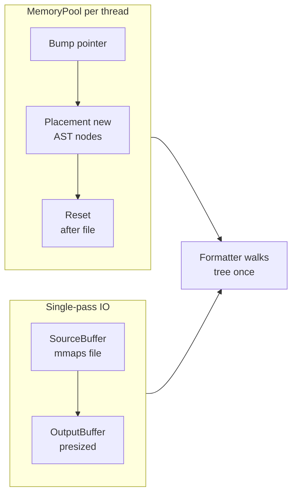

## Configuration flow

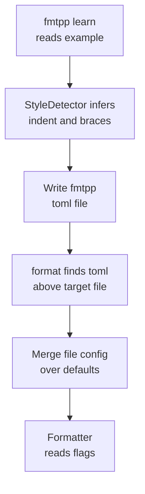

## Testing pyramid

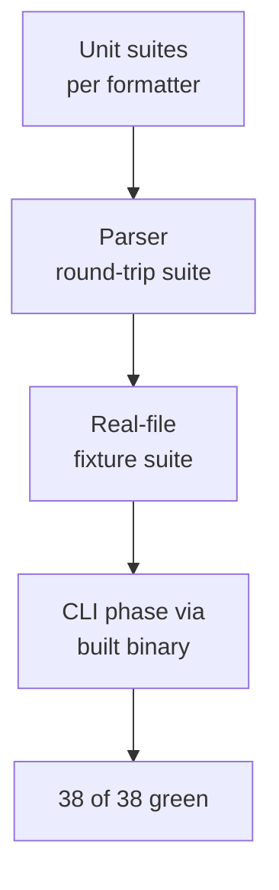

## Anatomy of a formatter

Every formatter is a visitor plus a set of overrides. The base owns
the boring parts; the subclass only teaches the differences:

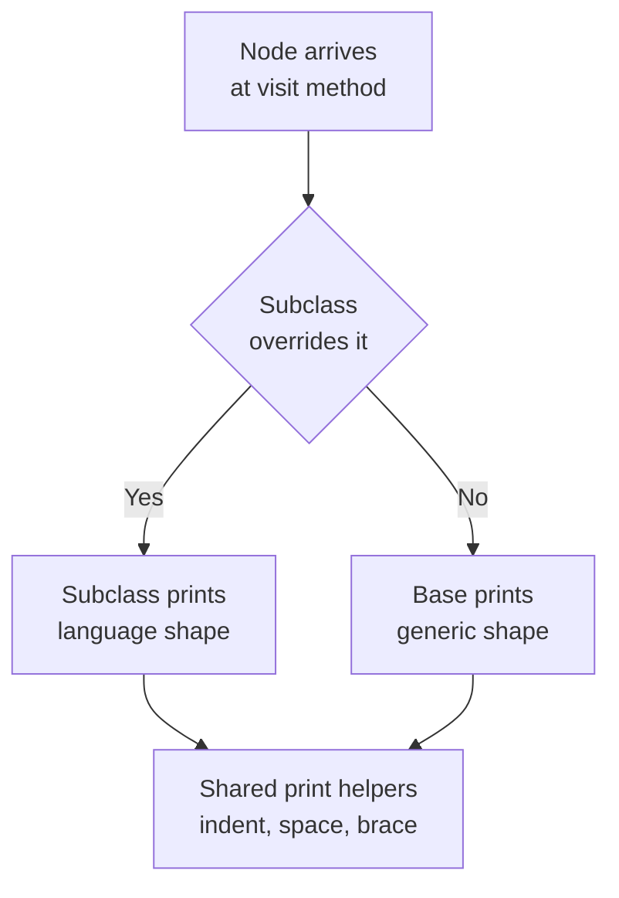

Concretely, adding support for one new construct means:

1. **Parse it** — extend the shared engine or a language branch in
   `src/Parser.cpp` so the construct becomes a node (or a `RawTextNode`
   if it should pass through verbatim).
2. **Print it** — override the matching `visit*` in the language
   formatter (e.g. `visitFunctionDecl` for brace style,
   `visitClassDecl` for `struct` kinds, `visitEnumDecl` for modifiers
   riding in `m_kind`).
3. **Cover it** — add a round-trip case to `tests/test_parser.cpp`,
   unit blocks to the language suite, and real files under
   `tests/e2e/<lang>/`.

Recent examples of this exact loop: `const enum` in TS (kind printed
verbatim), `public enum` / `private interface` modifiers, and the
C-versus-C++ function brace split (`printSpace` vs
`printNewline` + `printIndent` before the body).

## Resource rules (binding)

- Every acquisition (`fopen`, `malloc`, `mmap`) lives in a RAII wrapper
  (`FileHandle`, `MallocBuffer`, `MmapRegion`) or a `goto`-cleanup
  function with a single exit label.
- No `shared_ptr`/`unique_ptr`, no lambdas/`std::function`, no
  `stringstream` on hot paths, no unexplained `auto`.
- JavaDoc-style comment on every class and public method.

## Current status

A real parser for all 26 languages, all formatters, config load/merge,
`learn` with source-text detection, TUI `config`, `bench`
(+`--compare`), thread-pool multi-file runs and npm packaging with five
prebuilt targets — implemented and tested (38 CTest suites plus npm
packaging tests).
