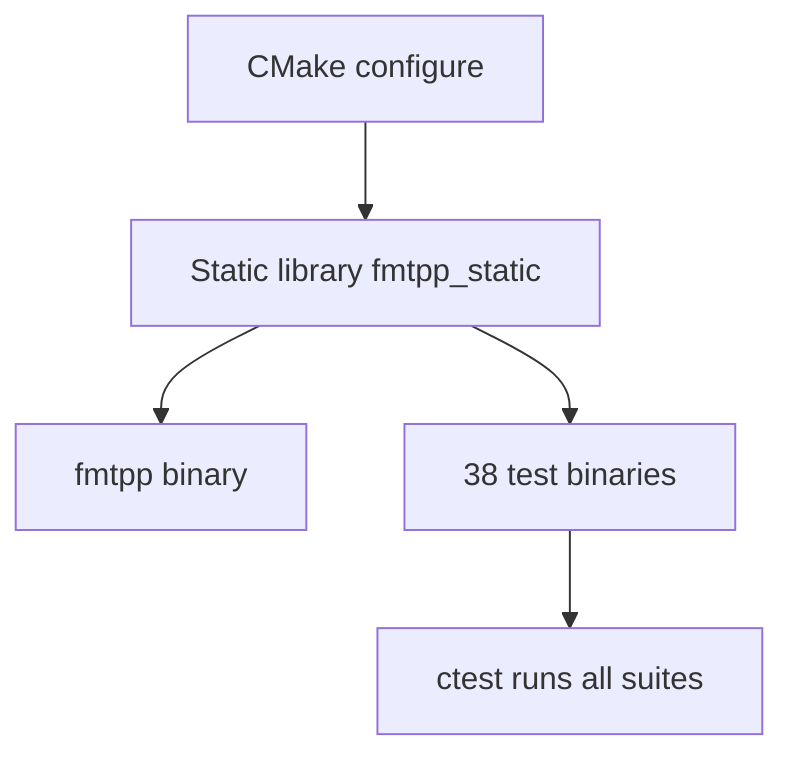

# Building



## Native build (any OS)

```sh
cmake -S . -B build
cmake --build build --config Release
```

Tested compilers: GCC 5+, Clang 6+, MSVC 2019+. The project targets
C++11 (`CMAKE_CXX_STANDARD 11`); the three toml++-including TUs compile
as C++17 via per-file flags (`-std=c++17` / `/std:c++17`).

| Requirement | Minimum | Notes |
|---|---|---|
| CMake | 3.16 | Configure + `enable_testing()` |
| Ninja or Make | any recent | Ninja preferred for speed |
| GCC / Clang / MSVC | 5+ / 6+ / 2019+ | C++11 mode; toml++ TUs use C++17 |
| zig cc | any recent | Only for cross builds and npm fallback |

CLI11 and toml++ are vendored under `lib/` and need no separate
install. `FetchContent` points at the local toml++ mirror first.

## What gets built

| Artifact | Description |
|---|---|
| `build/fmtpp` (`.exe` on Windows) | The static CLI binary |
| `build/fmtpp_static.lib` / `.a` | Static library backing tests |
| `build/test_*` | 38 test binaries (one per suite) |

Run the suite after every build:

```sh
ctest --test-dir build --output-on-failure
```

Stale objects after switching branches or toolchains cause confusing
link errors. When in doubt, wipe the directory — configure is fast:

```sh
rm -rf build && cmake -S . -B build && cmake --build build --config Release
```

Keep `build/` (normal), `build-sanitize/` (UB), and `build-cross/`
(cross) side by side instead of reconfiguring one directory back and
forth; all three are git-ignored.

## Build options

| CMake flag | Default | Effect |
|---|---|---|
| `FMTPP_SANITIZE_UB` | `OFF` | `-fsanitize=undefined` QA build |
| `FETCHCONTENT_SOURCE_DIR_TOMLPLUSPLUS` | `lib/tomlplusplus` | Local toml++ mirror |
| `CMAKE_TOOLCHAIN_FILE=toolchain.cmake` + `-DTARGET=<t>` | — | Cross-compile (below) |

UB sanitizer QA run:

```sh
cmake -S . -B build-sanitize -DFMTPP_SANITIZE_UB=ON
cmake --build build-sanitize
ctest --test-dir build-sanitize --output-on-failure
```

## Portability notes

- **Linking.** Fully-static `-static` is applied on Linux only. macOS
  (linker forbids it) and Windows/MSVC get no extra flags; Windows/MinGW
  gets `-static-libstdc++ -static-libgcc`. `ws2_32` links on Windows only.
- **SIMD.** toml++ uses SSE2 intrinsics on x86-64. A configure-time
  compile+link test (`FMTPP_HAVE_WORKING_SSE2`) detects toolchains that
  cannot link them and sets `TOML_ENABLE_SIMD=0` (scalar fallback) for
  those builds only. Working toolchains keep SIMD automatically — no
  manual flags, no arch enumeration.
- **UB sanitizer.** `cmake -S . -B build-sanitize -DFMTPP_SANITIZE_UB=ON`
  builds with `-fsanitize=undefined` for QA runs.

## Cross-compilation (npm targets)

```sh
bash scripts/build-all.sh
```

Uses `zig cc` via `toolchain.cmake` for `linux-x64`, `linux-arm64`,
`macos-x64`, `macos-arm64`, `windows-x64`. Output lands in
`npm/<platform-arch>/`. Single target:

```sh
cmake -S . -B build-cross -DCMAKE_TOOLCHAIN_FILE=toolchain.cmake -DTARGET=linux-arm64
cmake --build build-cross --config Release
```

## npm layout

`index.js` resolves `npm/<platform-arch>/fmtpp[.exe]` via
`getPlatformKey()` (`win`/`macos`/`linux` × `x64`/`arm64`), else compiles
from source with `zig cc`. `FMTPP_BINARY` overrides resolution.
Details: [Node API](./node-api.md).
