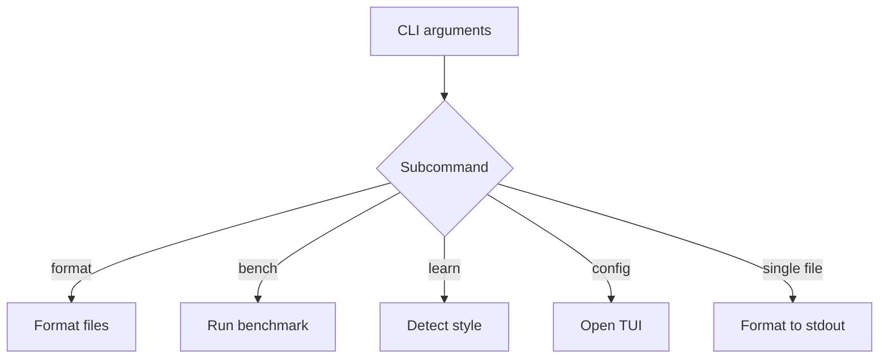

# CLI reference

```sh
fmtpp [OPTIONS] [FILE]
fmtpp <command> [options]
```



## Commands

| Command | Description |
|---|---|
| `fmtpp format <file>` | Format one file, code to stdout (file untouched) |
| `fmtpp format <file...>` | Format N files in parallel, prints a status report |
| `fmtpp <file>` | Shorthand: format a single file |
| `fmtpp bench <file> [--runs N] [--compare <tool>]` | Benchmark formatting (`oxfmt`, `prettier` as comparison) |
| `fmtpp learn <file> [--output .fmtpp.toml]` | Detect style from a file, write config |
| `fmtpp config` | Interactive TUI configurator (needs a terminal) |

## Global flags

| Flag | Description |
|---|---|
| `--version, -v` | Print `fmtpp 0.1.0` |
| `--help, -h` | Print help |
| `--easter-egg` | Print a random easter egg |
| `--cowbell` | More cowbell! |
| `--kittens` | Print ASCII kitten art |
| `--unicorn` | Print ASCII unicorn art |

## format

One file goes to stdout:

```sh
fmtpp format src/main.js
fmtpp src/main.js            # shorthand for a single file
fmtpp format a.js b.go c.rs  # multi-file (parallel) run
```

A real multi-file run looks like this:

```text
Formatting 2 files with 16 threads...
  Formatted: demo-a.js
  Formatted: demo-b.go
Done: 2 succeeded, 0 failed
The thread pool has done its parallel dance
```

The worker count comes from `hardware_concurrency()`; language is
detected per file, so mixed-extension runs format each file correctly.
Results are collected in order via futures. See
[Usage](./usage.md) for in-place rewrite recipes.

## bench

```sh
fmtpp bench app.js --runs 100
fmtpp bench app.js --runs 20 --compare oxfmt
```

Runs the formatter N times (with warmup) and prints average time.
With `--compare`, the baseline tool is timed on the same file and a
speedup report is printed. A short run:

```text
fmtpp Benchmark
  Files: 1
  Iterations: 3
  Language: js
  Warmup: yes
The benchmarker is warming up...
  Warmup run...
  Iteration 1/3...
  Iteration 2/3...
  Iteration 3/3...
```

Full guide: [Benchmarking](./benchmarking.md).

## learn

```sh
fmtpp learn example.js --output .fmtpp.toml
```

Runs `StyleDetector` over the file (indent, brace placement,
semicolons, trailing commas, print width, spacing, final newline) and
writes the result as TOML. For `function add(a,b){return a+b;}`:

```text
Style detected and written to .fmtpp.toml
Detected settings:
  printWidth: 80
  tabWidth: 2
  useTabs: false
  semi: true
  singleQuote: false
  braceStyle: same-line
  endOfLine: lf
```

## config

```sh
fmtpp config
```

Launches the interactive TUI configurator to edit `.fmtpp.toml`
without touching TOML by hand. Needs a real terminal (no pipes).

## Exit codes

`0` on success. `format` on multiple files returns `1` if any file
failed; unreadable or unparsable files report `Error: ...` and return `1`.

| Situation | Code |
|---|---|
| Format/bench/learn succeeded | `0` |
| Any file failed in a multi-file `format` | `1` |
| Unreadable file, bad arguments | `1` |

## Full help text

`fmtpp --help` (v0.1.0), for reference:

```text
fmtpp v0.1.0 - A professional code formatter


fmtpp [OPTIONS] [files...] [SUBCOMMANDS]


POSITIONALS:
  files TEXT ...              Format a single file directly

OPTIONS:
  -v,     --version           Display program version information and exit
  -h,     --help              Print this help message

SUBCOMMANDS:
  format                      Format one or more files
  bench                       Run performance benchmark
  config                      Launch interactive TUI configurator
  learn                       Learn style from a file and generate .fmtpp.toml
```
