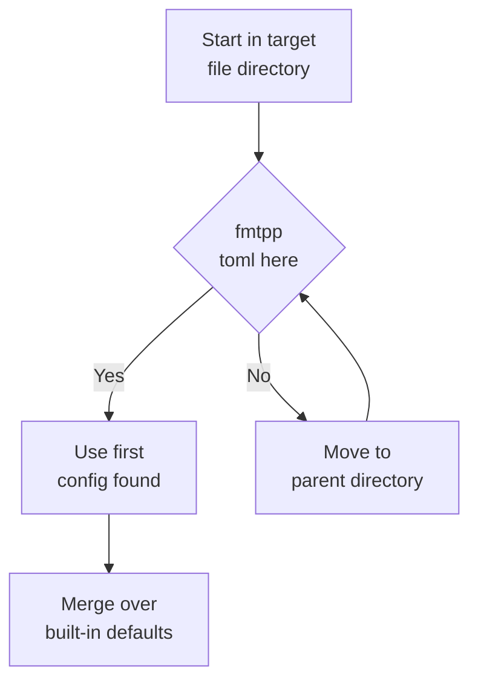

# Configuration

`fmtpp` reads `.fmtpp.toml` (TOML, parsed with toml++). Defaults mirror
Prettier.



## Config resolution

`format` looks for `.fmtpp.toml` starting in the **formatted file's own
directory**, then each parent directory (same rule as Prettier). The
first config found wins; a missing or unparseable file silently falls
back to defaults. Unknown keys are ignored. If your config seems
ignored, check it sits next to (or above) the file you format — not
just in your shell's working directory.

::: warning
`learn` writes every key it knows, so a generated file lists more keys
than older examples show. All of them are real — see the full table
below.
:::

## Generating config

```sh
fmtpp learn example.js --output .fmtpp.toml  # detect style from a file
fmtpp config                                 # edit interactively (TUI)
```

`learn` runs `StyleDetector` over the file (indent, brace placement,
semicolons, trailing commas, print width, spacing, final newline) and
writes the result as TOML.

## Options

| Key | Type | Default | Description |
|---|---|---|---|
| `printWidth` | int | `80` | Max line width before wrapping |
| `useTabs` | bool | `false` | Tabs instead of spaces |
| `tabWidth` | int | `2` | Spaces per indent level |
| `semi` | bool | `true` | Semicolons at statement ends |
| `singleQuote` | bool | `false` | Single instead of double quotes |
| `trailingComma` | string | `"es5"` | `"none"`, `"es5"` or `"all"` |
| `bracketSpacing` | bool | `true` | Spaces inside `{ braces }` |
| `arrowParens` | string | `"always"` | Parens around arrow-fn params (`"always"` or `"as-needed"`) |
| `endOfLine` | string | `"lf"` | `"lf"`, `"crlf"`, `"cr"`, `"auto"` |
| `braceStyle` | string | `"same-line"` | `"same-line"` (K&R) or `"next-line"` (Allman) |
| `spaceBeforeBrace` | bool | `true` | Space before `{` |
| `spaceAfterKeyword` | bool | `true` | Space after `if`, `for`, `while` |
| `spaceAroundOperators` | bool | `true` | Spaces around binary operators |
| `proseWrap` | string | `"preserve"` | How prose is wrapped (`"preserve"` keeps line breaks as written) |
| `htmlWhitespaceSensitivity` | string | `"css"` | HTML whitespace rules (`"css"` follows CSS display rules) |
| `vueIndentScriptAndStyle` | bool | `false` | Indent `<script>`/`<style>` inside Vue SFCs |
| `embeddedLanguageFormatting` | string | `"auto"` | Format embedded blocks (`"auto"` formats them) |
| `singleAttributePerLine` | bool | `false` | One HTML/Vue attribute per line |

Which options matter most depends on the language family:

- **C-style braces** (`js` → `zig`): `braceStyle`, `semi`,
  `spaceBeforeBrace`, `spaceAfterKeyword`.
- **Python/Ruby**: `useTabs`/`tabWidth` (indent is syntax),
  `printWidth`; `semi` is ignored (no semicolons emitted).
- **HTML/Vue**: `htmlWhitespaceSensitivity`,
  `vueIndentScriptAndStyle`, `singleAttributePerLine`,
  `embeddedLanguageFormatting` (whether `<script>`/`<style>` blocks
  are sub-formatted).
- **Prose-ish content**: `proseWrap`.

## Example

```toml
printWidth = 100
useTabs = false
tabWidth = 2
semi = true
singleQuote = true
trailingComma = "all"
bracketSpacing = true
braceStyle = "same-line"
```

A Vue-heavy project might add:

```toml
vueIndentScriptAndStyle = true
singleAttributePerLine = true
embeddedLanguageFormatting = "auto"
htmlWhitespaceSensitivity = "css"
```

## Precedence

Command line has no per-run overrides: the file's nearest
`.fmtpp.toml` wins over built-ins, full stop. To format one directory
differently, put a second `.fmtpp.toml` in it — resolution starts at
the file, so the closer file always wins.

## Monorepo patterns

A polyglot repo usually wants one root config plus a few overrides:

```text
repo/
  .fmtpp.toml            # printWidth = 100, defaults for everything
  web/
    .fmtpp.toml          # singleQuote = true (JS-heavy subtree)
  legacy/
    .fmtpp.toml          # braceStyle = "next-line" (Allman codebase)
  generated/
    # no config + never formatted: exclude the directory in CI instead
```

Because lookup starts at the formatted file, `web/app.js` picks up
`web/.fmtpp.toml` while `tool/main.go` falls back to the root file.
Keep each file minimal — only the keys that differ — so the root file
stays the single source of truth. Unknown keys are ignored, so a
comment noting *why* an override exists never hurts:

```toml
# Legacy engine code follows Allman braces; do not "fix" to same-line.
braceStyle = "next-line"
```
