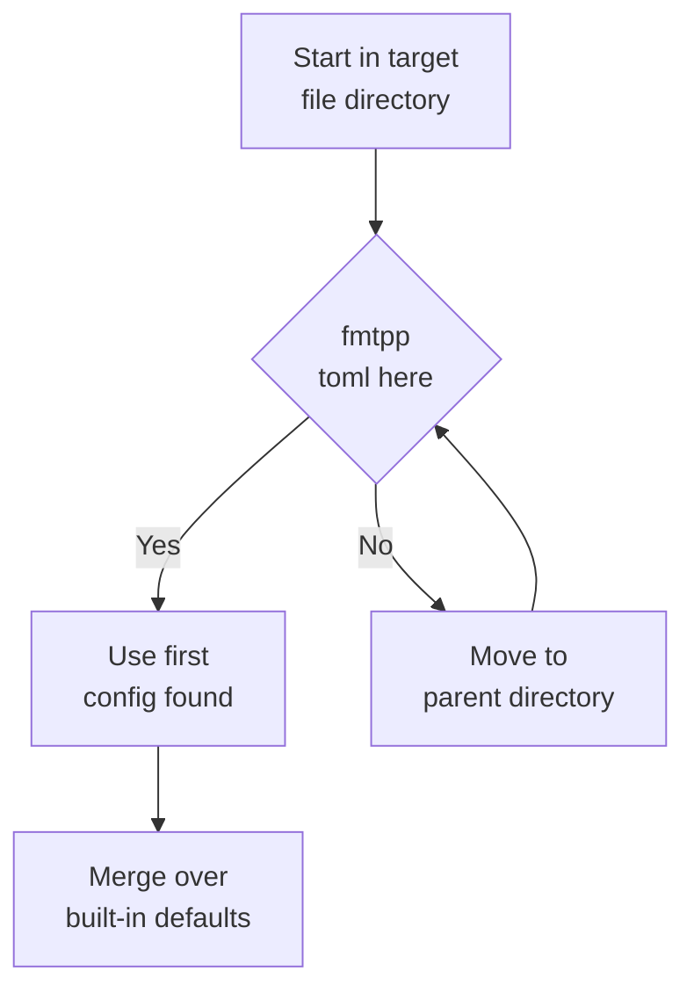

# Configuration

`fmtpp` reads `.fmtpp.toml` (TOML, parsed with toml++). Defaults mirror
Prettier.



## Config resolution

`format` looks for `.fmtpp.toml` starting in the **formatted file's own
directory**, then each parent directory (same rule as Prettier). The
first config found wins; a missing or unparseable file silently falls
back to defaults. Unknown keys are ignored. If your config seems
ignored, check it sits next to (or above) the file you format — not
just in your shell's working directory.

::: warning
`learn` writes every key it knows, so a generated file lists more keys
than older examples show. All of them are real — see the full table
below.
:::

## Options

Core options (Prettier-compatible):

| Key | Type | Default | Description |
|---|---|---|---|
| `printWidth` | int | `80` | Max line width before wrapping |
| `useTabs` | bool | `false` | Tabs instead of spaces |
| `tabWidth` | int | `2` | Spaces per indent level |
| `semi` | bool | `true` | Semicolons at statement ends |
| `singleQuote` | bool | `false` | Single instead of double quotes |
| `trailingComma` | string | `"es5"` | `"none"`, `"es5"` or `"all"` |
| `bracketSpacing` | bool | `true` | Spaces inside `{ braces }` |
| `arrowParens` | string | `"always"` | Parens around arrow-fn params (`"always"` or `"as-needed"`) |
| `endOfLine` | string | `"lf"` | `"lf"`, `"crlf"`, `"cr"`, or `"auto"` (sniff source) |
| `braceStyle` | string | `"same-line"` | Block-body braces: `"same-line"` (K&R) or `"next-line"` (Allman) |
| `spaceBeforeBrace` | bool | `true` | Space before `{` |
| `spaceAfterKeyword` | bool | `true` | Space after `if`, `for`, `while` |
| `spaceAroundOperators` | bool | `true` | Spaces around binary operators |

Blank lines (input separators are preserved up to `maxBlankLines`):

| Key | Type | Default | Description |
|---|---|---|---|
| `preserveBlankLines` | bool | `true` | Re-emit blank lines the source had |
| `maxBlankLines` | int | `1` | Cap on consecutive blanks (`0`–`9`; `0` strips all) |
| `blankLineAtFileStart` | bool | `false` | Keep a leading blank line |
| `blankLineAfterImports` | bool | `false` | Blank line after trailing import block |
| `blankLineBeforeReturn` | bool | `false` | Blank line before `return` |
| `blankLinesAroundTopLevelDefs` | int | `0` | Blanks around top-level Python `def`/`class` (`0`–`2`) |
| `finalNewline` | bool | `true` | End file with exactly one newline |
| `indentEmptyLines` | bool | `false` | Indent preserved blank lines |

Brace placement (`"auto"` keeps the per-language house style):

| Key | Type | Default | Description |
|---|---|---|---|
| `braceStyleFunctions` | string | `"auto"` | Function braces: `"auto"`, `"same-line"`, `"next-line"` |
| `braceStyleTypes` | string | `"auto"` | Class/struct/interface/enum braces |

Spacing:

| Key | Type | Default | Description |
|---|---|---|---|
| `spaceAfterComma` | bool | `true` | `f(a, b)` vs `f(a,b)` |
| `spaceAfterColon` | bool | `true` | `x: int`, `a: 1`, `color: red` |
| `spaceBeforeFunctionParen` | bool | `false` | `f ()` vs `f()` |
| `spaceInParens` | bool | `false` | `f( x )` vs `f(x)` |
| `spaceInCondParens` | bool | `false` | `if ( x )` (C-style control parens) |
| `spaceInBrackets` | bool | `false` | `[ 1 ]` vs `[1]` |
| `arrowSpacing` | bool | `true` | `(x) => y` vs `(x)=>y` |
| `templateExprSpacing` | bool | `false` | `` `${ x }` `` vs `` `${x}` `` |
| `spaceAroundAssignment` | bool | `true` | `x = 1` vs `x=1` (declarations) |

Quotes, blocks, switch:

| Key | Type | Default | Description |
|---|---|---|---|
| `quoteAvoidEscape` | bool | `true` | Keep `"` when `'` would need escapes |
| `emptyBlockSameLine` | bool | `false` | Empty blocks print `{}` |
| `indentSwitchCase` | bool | `true` | Outdent `case` labels, indent bodies |

Keyword placement (`"auto"` preserves input, `"always"` forces a new
line, `"never"` joins with a space):

| Key | Type | Default | Description |
|---|---|---|---|
| `elseOnNewLine` | string | `"auto"` | `} else` vs `}` + `else` |
| `catchOnNewLine` | string | `"auto"` | `} catch` vs `}` + `catch` |
| `finallyOnNewLine` | string | `"auto"` | `} finally` vs `}` + `finally` |
| `joinElseIf` | bool | `true` | `elseif` becomes `else if` |

Detection:

| Key | Type | Default | Description |
|---|---|---|---|
| `detectShebangLanguage` | bool | `true` | `#!` interpreter maps unknown extensions |
| `defaultLanguage` | string | `"js"` | Fallback for unknown extensions |
| `emitBom` | bool | `false` | Prepend a UTF-8 BOM to output |
| `proseWrap` | string | `"preserve"` | How prose is wrapped (`"preserve"` keeps line breaks as written) |
| `htmlWhitespaceSensitivity` | string | `"css"` | HTML whitespace rules (`"css"` follows CSS display rules) |
| `vueIndentScriptAndStyle` | bool | `false` | Indent `<script>`/`<style>` inside Vue SFCs |
| `embeddedLanguageFormatting` | string | `"auto"` | Format embedded blocks (`"auto"` formats them) |
| `singleAttributePerLine` | bool | `false` | One HTML/Vue attribute per line |

Which options matter most depends on the language family:

- **C-style braces** (`js` → `zig`): `braceStyle`,
  `braceStyleFunctions`, `braceStyleTypes`, `semi`,
  `spaceBeforeBrace`, `spaceAfterKeyword`, `indentSwitchCase`,
  `elseOnNewLine`/`catchOnNewLine`/`finallyOnNewLine`.
- **Python/Ruby**: `useTabs`/`tabWidth` (indent is syntax),
  `printWidth`, `blankLinesAroundTopLevelDefs`; `semi` is ignored (no
  semicolons emitted).
- **HTML/Vue**: `htmlWhitespaceSensitivity`,
  `vueIndentScriptAndStyle`, `singleAttributePerLine`,
  `embeddedLanguageFormatting` (`"off"` prints embedded blocks
  verbatim instead of sub-formatting them).
- **Prose-ish content**: `proseWrap`.

## Per-language overrides

Any key can be scoped with a `[language.<name>]` table using the
canonical codes (`js`, `ts`, `python`, `cpp`, …):

```toml
tabWidth = 2

[language.python]
tabWidth = 4

[language.go]
useTabs = true
```

Overrides merge over the top level for matching files only; unknown
languages and unknown keys are ignored.

## Generating config (learn)

`learn` detects brace style, indentation, semicolons, quotes, spacing
(`spaceAfterComma`, `spaceAfterColon`, `spaceInParens`,
`spaceAroundAssignment`, `arrowParens`, `templateExprSpacing`),
line endings, trailing commas, blank-line runs, `catch`/`else`
placement, `elseif` spelling, empty-block style, and BOM/final-newline
markers — then writes every key so the file round-trips byte-identical
formatting for the learned style.

## Example

```toml
printWidth = 100
useTabs = false
tabWidth = 2
semi = true
singleQuote = true
trailingComma = "all"
bracketSpacing = true
braceStyle = "same-line"
```

A Vue-heavy project might add:

```toml
vueIndentScriptAndStyle = true
singleAttributePerLine = true
embeddedLanguageFormatting = "auto"
htmlWhitespaceSensitivity = "css"
```

## Precedence

Command line has no per-run overrides: the file's nearest
`.fmtpp.toml` wins over built-ins, full stop. To format one directory
differently, put a second `.fmtpp.toml` in it — resolution starts at
the file, so the closer file always wins.

## Monorepo patterns

A polyglot repo usually wants one root config plus a few overrides:

```text
repo/
  .fmtpp.toml            # printWidth = 100, defaults for everything
  web/
    .fmtpp.toml          # singleQuote = true (JS-heavy subtree)
  legacy/
    .fmtpp.toml          # braceStyle = "next-line" (Allman codebase)
  generated/
    # no config + never formatted: exclude the directory in CI instead
```

Because lookup starts at the formatted file, `web/app.js` picks up
`web/.fmtpp.toml` while `tool/main.go` falls back to the root file.
Keep each file minimal — only the keys that differ — so the root file
stays the single source of truth. Unknown keys are ignored, so a
comment noting *why* an override exists never hurts:

```toml
# Legacy engine code follows Allman braces; do not "fix" to same-line.
braceStyle = "next-line"
```
