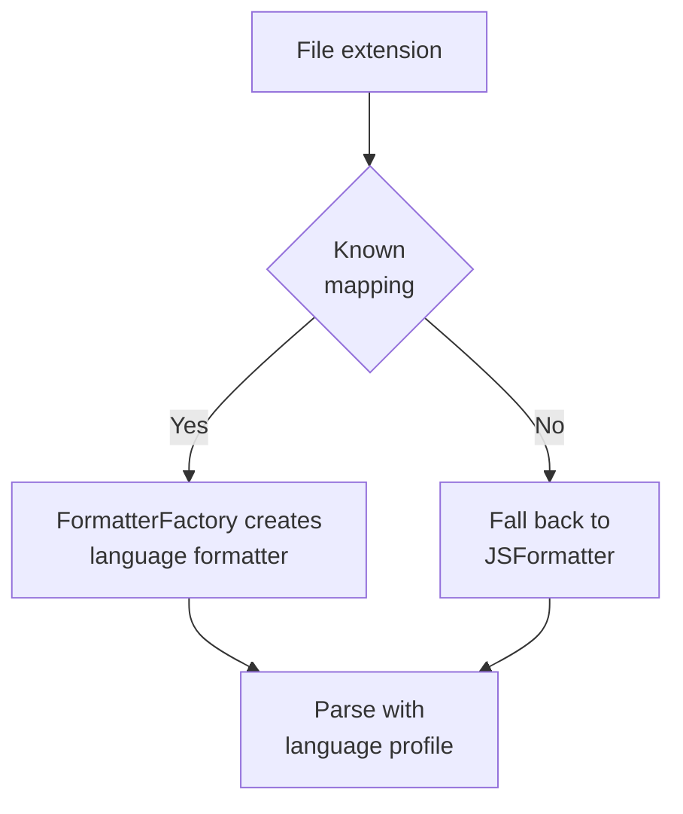

# Languages

Language is detected from the file extension. Unknown extensions fall
back to JavaScript.



## Detection rules

`FormatterFactory::detectLanguage` implements three fallbacks, in order:

1. **No path or no extension** → `js`.
2. **Unknown extension** → `js`.
3. Otherwise the table below.

Surprising-but-correct cases: `.h` is C (not C++), `.m`/`.mm` is
Objective-C, `.v` is V, `.sc` is Scala, `.fs` is a GLSL fragment
shader, `.svg`/`.xml` are HTML, `.scss`/`.less` are CSS, and `.json`
is parsed strictly then printed with the JS object/array printers.

| Language | Extensions | Class | Reference |
|---|---|---|---|
| JavaScript | `.js` `.mjs` `.cjs` `.jsx` | `JSFormatter` | Prettier |
| TypeScript | `.ts` `.tsx` `.mts` `.cts` | `TSFormatter` | Prettier |
| Java | `.java` | `JavaFormatter` | google-java-format |
| C | `.c` `.h` | `CFormatter` | clang-format |
| C++ | `.cpp` `.cc` `.cxx` `.hpp` `.hh` `.hxx` `.ino` `.cu` `.cuh` | `CppFormatter` | clang-format |
| C# | `.cs` | `CSharpFormatter` | `dotnet format` |
| Go | `.go` | `GoFormatter` | gofmt |
| Rust | `.rs` | `RustFormatter` | rustfmt |
| Kotlin | `.kt` `.kts` | `KotlinFormatter` | ktfmt |
| Swift | `.swift` | `SwiftFormatter` | swift-format |
| Dart | `.dart` | `DartFormatter` | dart format |
| PHP | `.php` `.phtml` | `PhpFormatter` | php-cs-fixer |
| Scala | `.scala` `.sc` | `ScalaFormatter` | scalafmt |
| Objective-C | `.m` `.mm` | `ObjectiveCFormatter` | clang-format |
| Zig | `.zig` `.zon` | `ZigFormatter` | zig fmt |
| D | `.d` `.di` | `DFormatter` | dfmt |
| Groovy | `.groovy` `.gvy` | `GroovyFormatter` | Spotless |
| Solidity | `.sol` | `SolidityFormatter` | prettier-plugin-solidity |
| V | `.v` `.vsh` `.vv` | `VFormatter` | v fmt |
| GLSL | `.glsl` `.vert` `.frag` `.geom` `.comp` `.tesc` `.tese` `.vs` `.fs` | `GlslFormatter` | clang-format |
| HTML/XML | `.html` `.htm` `.xhtml` `.svg` `.xml` | `HtmlFormatter` | Prettier |
| CSS | `.css` `.scss` `.less` | `CssFormatter` | Prettier |
| JSON | `.json` | `JSFormatter` | Prettier |
| Vue SFC | `.vue` | `VueFormatter` | Prettier/Volar |
| Python | `.py` `.pyw` `.pyi` | `PythonFormatter` | black |
| Ruby | `.rb` | `RubyFormatter` | rubocop |

The factory also accepts language aliases (`javascript`, `c++`,
`csharp`, `c#`, `rust`, `objective-c`, `vlang`, `xml`, `python`/`py`,
`ruby`/`rb`, …) for API and test use.

## Detection edge cases

Files with no extension — or an extension nobody claims — format as
JavaScript:

```sh
fmtpp format snippet   # contains function f(){return 1;}
```

```js
function f() {
  return 1;

}
```

Headers need care: `.h` is C while `.hpp`/`.hh`/`.hxx` are C++, so a
C++-only header named `.h` formats with C rules (same-line function
braces instead of Allman). Rename it or accept the difference.
Likewise `.m` is Objective-C (MATLAB users beware) and `.v` is V, not
Verilog. When in doubt, check the table above — then check the
[Style reference](./style-reference.md) for what the detected
language actually does to your construct.

## How it maps

All C-style languages share `CstyleFormatterBase` (indent, braces,
semicolons, spacing, wrapping, comments) and override per-language
pieces. Verified before/after pairs for every language live in the
[Style reference](./style-reference.md).

### Brace families

| Style | Languages | Example |
|---|---|---|
| Same-line (K&R) | C, Java, C#, Go, Rust, Swift, Dart, PHP, Groovy, Solidity, V, GLSL, JS, TS functions | `int add(int a, int b) {` |
| Allman (next line) | C++ functions, C structs, TS methods, C# types | `int f()` newline `{` |
| Colon suites | Python | `def add(a, b=1):` |
| `end` suites | Ruby | `def add(a)` … `end` |

### Per-language notes

- **JS** — `function` keyword, `let`/`const`/`var`, imports/exports,
  classes, arrow functions (`arrowParens: "as-needed"` drops
  single-param parens), template literals.
- **TS** (extends JS) — return-type annotations, `interface`, `enum`
  (including `const enum` via `m_kind`), `type` aliases, generics.
  Class methods print the brace on the next line.
- **Java** — `public` methods, `class … extends … implements …`,
  `import …;`, `package …;`, verbatim `switch` cases, full
  `try`/`catch`/`finally` with catch bodies.
- **C** — `Ret name(…)` functions, `#include`/`#define` passthrough,
  `;`-terminated enums. Structs print Allman with a bare `}`.
- **C++** (extends C) — `class`/`struct`/`union` with kinds and trailing
  `;`, `: public Base` inheritance, `namespace`, templates, `noexcept`.
- **C#** — `public class … : Base, IFace`, `public Ret Name(…)`,
  `namespace`, `public interface … : …`.
- **Go** (standalone visitor) — `func`, `x := v`, `var x T`, no
  semicolons except `for` headers, `type … struct`, `type … interface`,
  real `package` clauses, `panic()`, `nil`.
- **Rust** (standalone visitor) — `[pub] fn … -> Ret`, `let [mut] …[: Ty]`,
  `use a::b;`, `match`, `panic!()`, `vec![…]`, `|…|` closures,
  `struct`/`impl`/`trait`/`enum`/`type`/`mod`, `None`.
- **Kotlin** (extends Java) — `fun …: Ret`, `class … : Super(), Trait`,
  `object`, `when`, `package`, no semicolons.
- **Swift** — `func … -> Ret` (`init`/`deinit` bare), `class`/`struct`,
  paren-less `for`-in and `switch`, no semicolons.
- **Dart** (extends C) — C-style functions, `class … extends …
  implements …`, quoted imports.
- **PHP** (extends C) — `[modifiers] function`, `$` variables,
  `use`/`namespace …;`, `<?php` passthrough.
- **Scala** (extends Java) — `def …: Ret`, `class`/`object`/`trait`,
  `match`, `package`, no semicolons. Short bodies stay inline.
- **Objective-C** (extends C) — `@interface`/`@implementation`/`@protocol`
  with `@end`, raw method signatures, plain C passes through.
- **Zig** — `fn … Ret`, `const`/`var` with types, `const x = @import(…);`,
  `const Name = struct|enum|union`, `for` captures.
- **D** (extends C) — `class … : Bases`, dotted imports, `module …;`.
- **Groovy** (extends Java) — `def`, constructor detection, `package`,
  no semicolons.
- **Solidity** (extends JS) — `contract … is …`, `function … modifiers
  returns`, quoted imports, `pragma` passthrough.
- **V** (extends Go) — `fn`, `mut x := v`, real `enum`, `module`,
  unquoted imports, verbatim `#flag` lines.
- **GLSL** (extends C) — `struct …;`, uniforms, `#version` passthrough.
- **HTML** — elements with attributes, inline text, void elements,
  comments, doctypes.
- **CSS** (extends C-style base) — `selector { prop: value; }` rules,
  `@import`, `@media` nesting.
- **JSON** — parsed strictly, printed compact on one line via the JS
  object/array printers.
- **Vue** (extends HTML) — `<template>` as HTML, `<script>` via JS/TS by
  `lang`, `<style>` via CSS. `vueIndentScriptAndStyle` and
  `singleAttributePerLine` tune the output.
- **Python** (extends `IndentFormatterBase`) — `def`/`class` with `:`
  suites (inline or indented), `if`/`elif`/`else`, `for`/`while` with
  `else`, `try`/`except`/`else`/`finally`, `with`, `match`/`case`,
  `import`/`from`, decorators, `async`.
- **Ruby** (extends `IndentFormatterBase`) — `def` (incl. endless)/
  `class`/`module` with `end`, `if`/`elsif`/`else`/`unless`,
  `case`/`when`/`in`/`else`, `begin`/`rescue`/`else`/`ensure` plus
  method-level rescue, `while`/`until`/`for`, `do` blocks, `require`,
  heredocs, `=begin` blocks, `__END__` tails.

Sample inputs for every language live in `tests/fixtures/sample.<ext>`,
with seven edge files each under `tests/e2e/<lang>/`.
