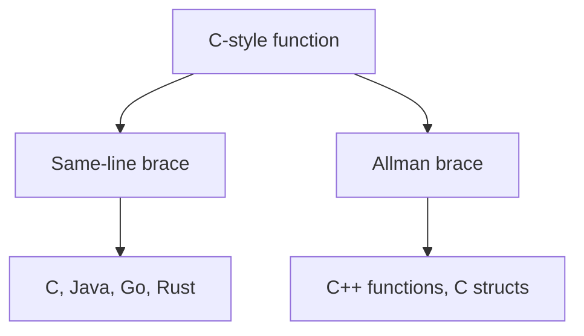

# Style reference

Every example below is the exact output of `fmtpp format` (v0.1.0,
default config) for the shown input. Nothing is hand-formatted.

Two brace styles exist. Most C-style formatters print the opening brace
on the same line (K&R). C++ and C structs print it on the next line
(Allman), and TypeScript methods do the same:



## JavaScript (`JSFormatter`)

```js
function add(a,b){return a+b;}
```

```js
function add(a,b) {
  return a+b;

}
```

**Loops:**

```js
for (let i = 0; i < 3; i++) {
d(i);
}
```

```js
for (let i = 0; i < 3; i++) {
  d(i);

}
```

## TypeScript (`TSFormatter`)

```ts
function id<T>(x:T):T{return x;}
```

```ts
function id<T>(x:T): T {
  return x;

}
```

Methods print the brace on the next line:

```ts
abstract class B {
abstract m(): void;
concrete() {
}
}
```

```ts
abstract class B {
  abstract m(): void;

  concrete()

  {

  }
}
```

**Type aliases and enums:**

```ts
type A = string;
enum E {
X,
}
```

```ts
type A = string;

enum E {
  X
}
```

## Java (`JavaFormatter`)

```java
public class Dog{public void bark(){}}
```

```java
public class Dog {
  public void bark() {

  }
}
```

**Fields and branches** (note `class` gains `public`, methods keep
same-line braces while the class itself is Allman):

```java
class A {
int x;
void m() {
if (x > 0) {
return;
}
}
}
```

```java
public class A {
  int x;

  public void m() {
    if (x > 0) {
      return;

    }
  }
}
```

## C (`CFormatter`)

Same-line braces. `#include` / `#define` pass through untouched.

```c
int add(int a,int b){return a+b;}
```

```c
int add(int a,int b) {
  return a+b;

}
```

Structs use Allman braces and a bare closing `}` (no semicolon):

```c
struct Node {
int v;
struct Node* next;
};
```

```c
struct Node

{
  int v;

  struct Node* next;

}
```

**Loops:**

```c
int f() {
for (int i = 0; i < 3; i++) {
g(i);
}
return 0;
}
```

```c
int f() {
  for (int i = 0; i < 3; i++) {
    g(i);

  }
  return 0;

}
```

## C++ (`CppFormatter`, extends C)

Allman braces for functions; `class` / `struct` / `union` keep their
kind and trailing `;`.

```cpp
int f(){return 1;}
```

```cpp
int f()
{
  return 1;

}
```

**Namespaces and inheritance:**

```cpp
namespace n {
class C : public B {
void m();
};
}
```

```cpp
namespace n {
  class C : public B {
    void m();

  };

}
```

## C# (`CSharpFormatter`)

```cs
public class C{public void M(){}}
```

```cs
public class C
{
  public void M()
  {

  }
}
```

**Interfaces** (members gain `public`):

```cs
public interface I {
void M();
}
```

```cs
public interface I
{
  public void M();

}
```

## Go (`GoFormatter`)

Blank line after `package`, no semicolons except `for` headers.

```go
package main
func main(){println(1)}
```

```go
package main

func main() {
  println(1)

}
```

**Branches:**

```go
func f() {
if a {
b()
} else {
c()
}
}
```

```go
func f() {
  if a {
    b()

  } else {
    c()

  }
}
```

## Rust (`RustFormatter`)

```rust
fn main()->i32{return 0;}
```

```rust
fn main() -> i32 {
  return 0;

}
```

**Match:**

```rust
fn f(x: i32) -> i32 {
match x {
0 => 1,
_ => 2,
}
}
```

```rust
fn f(x: i32) -> i32 {
  match x {
    0 => 1,
    _ => 2,
  }

}
```

## Kotlin (`KotlinFormatter`)

```kotlin
fun add(x:Int):Int{return x}
```

```kotlin
fun add(x:Int):Int

{
  return x};

}
```

::: warning
Kotlin function bodies currently keep Allman-style separation quirks
(`:` return handling with the brace on its own line). Output is stable
and idempotent, but not yet ktfmt-identical.
:::

**Top-level declarations:**

```kotlin
val x = 5
var y: String = "hi"
```

```kotlin
val x = 5

var y: String = "hi"

```

## Swift (`SwiftFormatter`)

```swift
func f()->Int{return 1}
```

```swift
func f() -> Int {
  return 1

}
```

**Branches:**

```swift
func f(x: Int) {
if x > 0 {
return
}
}
```

```swift
func f(x: Int) {
  if x > 0 {
    return

  }
}
```

## Dart (`DartFormatter`)

```dart
void main(){print(1);}
```

```dart
void main() {
  print(1);

}
```

**Loops:**

```dart
void f() {
for (var i = 0; i < 3; i++) {
g(i);
}
}
```

```dart
void f() {
  for (var i = 0; i < 3; i++) {
    g(i);

  }
}
```

## PHP (`PhpFormatter`)

`<?php` and `namespace …;` pass through; `$` variables kept.

```php
<?php
function f($x){return $x;}
```

```php
<?php

function f($x) {
  return $x;

}
```

**Branches** (`elseif` normalizes to `else if`):

```php
<?php
if ($a) {
b();
} elseif ($c) {
d();
} else {
e();
}
```

```php
<?php

if ($a) {
  b();

} else if ($c) {
  d();

} else {
  e();

}
```

## Scala (`ScalaFormatter`)

Short bodies stay inline.

```scala
def add(x:Int):Int={x}
```

```scala
def add(x:Int): Int={x}
```

**Match:**

```scala
x match {
case 1 => one()
case _ => other()
}
```

```scala
x match {
  case 1 => one()

  case _ => other()

}
```

## Objective-C (`ObjectiveCFormatter`)

```objc
@implementation Dog
- (void)bark{}
@end
```

```objc
@implementation Dog

- (void)bark

{

}
@end
```

**Protocols:**

```objc
@protocol P
- (void)m;
@end
```

```objc
@protocol P
- (void)m;

@end

```

## Zig (`ZigFormatter`)

```zig
fn add(a:i32,b:i32)i32{return a+b;}
```

```zig
fn add(a:i32,b:i32) i32 {
  return a+b;

}
```

**Branches:**

```zig
fn f() void {
if (true) {
return;
}
}
```

```zig
fn f() void {
  if (true) {
    return;

  }
}
```

## D (`DFormatter`)

```d
int add(int a,int b){return a+b;}
```

```d
int add(int a,int b) {
  return a+b;

}
```

**Foreach** (note the space after `foreach` is dropped):

```d
foreach (x; items) {
use(x);
}
```

```d
foreach(x; items) {
  use(x);

}
```

## Groovy (`GroovyFormatter`)

```groovy
def greet(name){println name}
```

```groovy
def greet(name) {
  println name

}
```

**Classes:**

```groovy
class C {
String greet(String n) {
return n
}
}
```

```groovy
class C {
  String greet(String n) {
    return n

  }
}
```

## Solidity (`SolidityFormatter`)

```sol
contract T{function f(uint x)public returns(uint){return x;}}
```

```sol
contract T {
  function f(uint x) public returns(uint) {
    return x;

  }
}
```

**State:**

```sol
contract Bank {
mapping(address => uint) balances;
}
```

```sol
contract Bank {
  mapping(address => uint) balances;

}
```

## V (`VFormatter`)

```v
fn add(a int)int{return a}
```

```v
fn add(a int) int {
  return a

}
```

**Structs:**

```v
struct Point {
x int
y int
}
```

```v
struct Point {
  x int

  y int

}
```

## GLSL (`GlslFormatter`)

```glsl
void main(){gl_FragColor=vec4(1.0);}
```

```glsl
void main() {
  gl_FragColor=vec4(1.0);

}
```

**Branches:**

```glsl
void main() {
if (x > 0.0) {
y = 1.0;
}
}
```

```glsl
void main() {
  if (x > 0.0) {
    y = 1.0;

  }
}
```

## HTML (`HtmlFormatter`)

```html
<div class="a"><p>hi</p></div>
```

```html
<div class="a">
  <p>hi</p>

</div>
```

**Lists:**

```html
<ul>
<li>a</li>
<li>b</li>
</ul>
```

```html
<ul>
  <li>a</li>

  <li>b</li>

</ul>

```

## CSS (`CssFormatter`)

```css
.a{color:red;}
```

```css
.a {
  color: red;

}
```

**Media queries:**

```css
@media screen {
.a {
color: red;
}
}
```

```css
@media screen {
  .a {
    color: red;

  }
}
```

## JSON (via `JSFormatter`)

Objects print compact on one line.

```json
{"b":2,"a":1}
```

```json
{ "b": 2, "a": 1 }
```

**Nesting and arrays:**

```json
{"a": [1, 2]}
```

```json
{ "a": [1, 2] }
```

## Vue SFC (`VueFormatter`)

Blocks are sub-formatted by inner language (`<template>` as HTML,
`<script>` as JS/TS, `<style>` as CSS).

```vue
<template><p>hi</p></template>
```

```vue
<template>
  <p>hi</p>

</template>
```

**Interpolation:**

```vue
<template>
<div>{{ msg }}</div>
</template>
```

```vue
<template>
  <div>{{ msg }}</div>

</template>

```

## Python (`PythonFormatter`)

Colon suites, two-space indent, blank line after blocks.

```python
def add(a,b=1):
 return a+b
```

```python
def add(a,b=1):
  return a+b

```

**Branches** (four-space input is normalized to two spaces):

```python
if a:
    b()
elif c:
    d()
else:
    e()
```

```python
if a:
  b()

elif c:
  d()

else:
  e()


```

## Ruby (`RubyFormatter`)

`end` suites, blank line before `end`.

```ruby
def add(a)
return a
end
```

```ruby
def add(a)
  return a

end
```

**Case:**

```ruby
case x
  when 1
    a
  else
    b
end
```

```ruby
case x
  when 1
    a

  else
    b

end

```

## Notes on stability

- Formatting twice is byte-identical for every sample above
  (the `test_e2e` suite checks this on 217 real files).
- Anything the parser does not understand is kept verbatim as
  `RawTextNode` — output is never invented, so unknown or invalid
  code passes through instead of corrupting.
- `learn` + `.fmtpp.toml` options (`braceStyle`, `semi`, `useTabs`,
  …) adjust spacing and braces; see [Configuration](./configuration.md).
