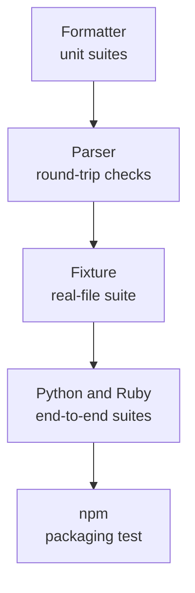
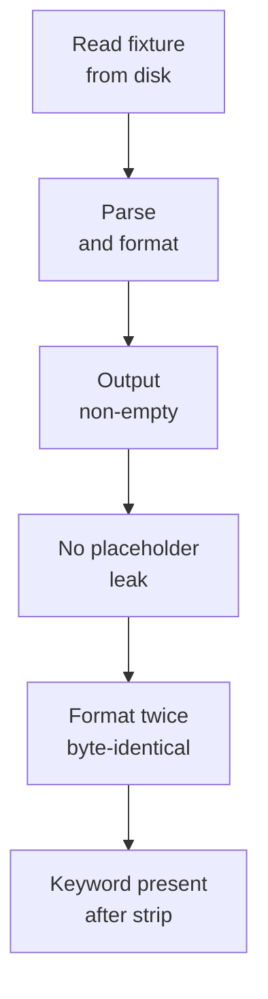

# Testing



## C++ suites (CTest)

38 suites, run from a configured build:

```sh
cmake -S . -B build && cmake --build build --config Release
ctest --test-dir build --output-on-failure
```

Targeted runs (from inside `build/`):

```sh
ctest -R javaformatter --output-on-failure   # one suite only
ctest -R "formatter"                         # all 25 formatter suites
./test_goformatter.exe                       # a suite binary directly
```

Note: `ctest` without `--test-dir build` from the repo root, or
`cmake --build build` from inside `build/`, fails with "not a
directory" / "no tests found" — the paths above are the ones that work.

## Suite catalog

25 formatter suites, one per language family member:

| Suite | Covers |
|---|---|
| `test_jsformatter` | `JSFormatter` — functions, arrows, classes, imports |
| `test_tsformatter` | `TSFormatter` — annotations, interfaces, `const enum` |
| `test_javaformatter` | `JavaFormatter` — classes, `switch`, `try/catch` |
| `test_cformatter` | `CFormatter` — same-line braces, preprocessor |
| `test_cppformatter` | `CppFormatter` — Allman braces, templates, namespaces |
| `test_csharpformatter` | `CSharpFormatter` — properties, interfaces |
| `test_goformatter` | `GoFormatter` — `func`, receivers, `select` |
| `test_rustformatter` | `RustFormatter` — `match`, traits, `impl` |
| `test_kotlinformatter` | `KotlinFormatter` — `when`, data classes |
| `test_swiftformatter` | `SwiftFormatter` — `init`, paren-less control flow |
| `test_dartformatter` | `DartFormatter` — constructors, loops |
| `test_phpformatter` | `PhpFormatter` — `$vars`, `foreach`, `elseif` |
| `test_scalaformatter` | `ScalaFormatter` — `match`, traits, generics |
| `test_objectivecformatter` | `ObjectiveCFormatter` — `@interface`/`@end` |
| `test_zigformatter` | `ZigFormatter` — `struct`/`enum` consts, captures |
| `test_dformatter` | `DFormatter` — modules, `foreach` |
| `test_groovyformatter` | `GroovyFormatter` — `def`, closures |
| `test_solidityformatter` | `SolidityFormatter` — contracts, events |
| `test_vformatter` | `VFormatter` — `match`, `mut` |
| `test_glslformatter` | `GlslFormatter` — uniforms, `main` |
| `test_htmlformatter` | `HtmlFormatter` — nesting, void elements |
| `test_cssformatter` | `CssFormatter` — rules, `@media` |
| `test_vueformatter` | `VueFormatter` — SFC blocks |
| `test_pythonformatter` | `PythonFormatter` — suites, `match`, decorators |
| `test_rubyformatter` | `RubyFormatter` — `end` suites, heredocs |

13 infrastructure suites:

| Suite | Covers |
|---|---|
| `test_ast` | All 31 AST node factory types |
| `test_parser` | 1100+ parser→formatter round trips, every language |
| `test_e2e` | 217 real files, 1491 checks (see below) |
| `test_pye2e` / `test_rbe2e` | Python/Ruby end-to-end corpora |
| `test_memorypool_astnode` | Pool edges, alignment, bulk allocation |
| `test_outputbuffer` | Growth, `printf` variants, flush |
| `test_configbuilder` | TOML keys, fallbacks, invalid input |
| `test_formatter_visitor` | Indent/width/semicolon primitives |
| `test_cstyle_formatter_base_core` | All 23 base visitors |
| `test_benchmark` | Stats, multi-file, compare mode |
| `test_threadpool` | Ordering, reuse, growth |
| `test_raii_wrappers` | File/mmap/malloc wrappers, move chains |

Every supported language has a dedicated formatter suite plus a sample
file under `tests/fixtures/`:

| Suite | Fixture |
|---|---|
| `test_jsformatter` | `sample.js` |
| `test_tsformatter` | `sample.ts` |
| `test_javaformatter` | `sample.java` |
| `test_cformatter` | `sample.c` |
| `test_cppformatter` | `sample.cpp` |
| `test_csharpformatter` | `sample.cs` |
| `test_goformatter` | `sample.go` |
| `test_rustformatter` | `sample.rs` |
| `test_pythonformatter` | `sample.py` |
| `test_rubyformatter` | `sample.rb` |

Suites follow one pattern: build ASTs via `ASTNodeFactory` on a local
`MemoryPool` (`g_pool`), format into an `OutputBuffer`, assert on
`strstr` of the output, print `N passed, M failed`, return nonzero on
failure. To add a language test, copy `test_cformatter.cpp` and register
the name in `FMTPP_TESTS` in `CMakeLists.txt`.

## What the real-file suite checks



`test_e2e` reads all 26 `tests/fixtures/sample.*` files plus the
`tests/e2e/<lang>/` corpora (usually seven files per language: basic,
control flow, stress, strings-with-braces, empty, comments-only,
invalid — JSON skips comments-only, Python/Ruby carry extra files).
Every file gets six checks: non-empty output, no `placeholder` leak,
byte-identical double format, keyword presence on stripped code,
brace balance, and wrong-language non-crash. A CLI phase re-runs all
fixtures through the built binary.

## Reading a result

A healthy suite ends like this (`test_goformatter`, 118 checks):

```text
Try/tags/comments: PASSED
Empty/verbatim/idempotent: PASSED

========================================
GoFormatter tests: 118 passed, 0 failed
========================================
```

A failure names the missing substring and prints the actual output,
so the fix is usually a wrong marker rather than a formatter bug:

```text
FAIL: [ts] marker missing: concrete() {
  output was: abstract class B {
  ...
```

Compare the printed output against the marker: if the output is right
(Allman brace, verbatim kind, bare `}`), fix the marker. If the output
is wrong, the formatter needs the fix — see
[Contributing](./contributing.md).

## npm packaging tests

```sh
npm test   # runs tests/test_npm_packaging.js
```

Covers `package.json` fields, platform-key detection, binary-path
resolution, binary slots for all five targets, `FMTPP_BINARY` override
and the compile-from-source fallback export.

## UB sanitizer

```sh
cmake -S . -B build-sanitize -DFMTPP_SANITIZE_UB=ON
cmake --build build-sanitize
ctest --test-dir build-sanitize --output-on-failure
```

Builds with `-fsanitize=undefined` for QA runs.

## Known flake

`test_threadpool` shares the global `MemoryPool` across worker threads
(`Parser::parse` calls `g_pool->reset()`), so it can rarely segfault
under load. It passes consistently on re-run; the proper fix is
per-thread pools (pending `ThreadPool`/`Parser` rework).
